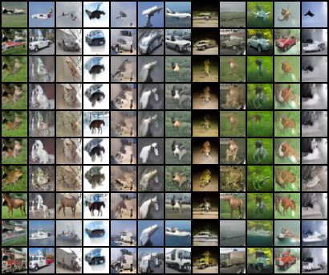

# Mini Conditional DDPM

以 PyTorch 實作的 CIFAR-10 類別條件影像生成專案，包含 U-Net、diffusion 訓練、取樣、EMA、評估程式與歷史結果。適合從程式追蹤小型生成模型的完整流程。

輸入是 0–9 的類別索引，輸出是 32 × 32 圖片。模型沒有自然語言文字編碼器。



圖為先前 Combo 模型生成樣本；公開版驗收用的隨機假資料不會產生這樣的品質。

## 這份作品包含什麼

- [U-Net](final_project/src/unet.py)：時間與類別嵌入、殘差區塊、可選的中間層 attention。
- [Diffusion](final_project/src/ddpm.py)：加噪、noise-prediction loss、linear／cosine schedule 與取樣。
- [訓練入口](final_project/src/train_ddpm.py)：checkpoint、恢復訓練、EMA 與常數標籤消融。
- [實驗設定](final_project/configs/)與[歷史結果](evidence/)，保留評估數量和比較限制。

## 快速檢查

Python 3.10+；本次 CPU 流程驗收使用 Python 3.12、PyTorch 2.7.1、torchvision 0.22.1。正式訓練建議使用 NVIDIA GPU。

```bash
python -m venv .venv
# 啟用 .venv 後，依硬體安裝相容的 torch / torchvision。
python -m pip install -r final_project/requirements-final.txt
python tools/smoke.py
```

`smoke.py` 在 CPU 上用 8 張假資料跑一個 epoch，重新載入 checkpoint，再產生 10 張類別樣本。它不下載 CIFAR-10，也不執行大型模型或 FID 評估。執行紀錄留在 `outputs/smoke-*`。

2026-10-09 已通過上述小型流程驗收。訓練程式仍使用舊版 AMP 呼叫，在驗收環境出現棄用提醒；尚未針對各版 PyTorch 做完整相容性測試。

## 正式訓練與取樣

以下命令會下載 CIFAR-10 並進行訓練，請先確認時間與儲存空間。

```bash
python final_project/src/train_ddpm.py --config final_project/configs/final_experiment.yaml
python final_project/src/sample_ddpm.py --config final_project/configs/final_experiment.yaml
```

[Combo 設定](final_project/configs/fid_combo_cosine_attention_base128_ema200.yaml)保留 cosine schedule、attention、base channels 128 與 EMA 的組合。各設定的 checkpoint／輸出路徑須與實際訓練產物對應；此公開版沒有附訓練權重。

FID、分類準確率和影像文字評估各有獨立入口；請先查看相應 `evaluate_*.py --help`。部分指標會另行下載評估模型。低解析度的類別條件模型與大型文字生成模型具有不同輸入、資料及算力條件，不宜直接用跨模型分數主張優劣。

## 歷史結果與限制

下表是原實驗 CSV 的結果，**此次公開整理沒有重新訓練或重算 FID**。每列使用 10,000 張生成圖與 10,000 張真實圖。

| 設定 | FID ↓ | Inception Score ↑ |
|---|---:|---:|
| Conditional，epoch 80 | 44.6658 | 5.6181 |
| 常數標籤消融，epoch 80 | 39.4599 | 5.9280 |
| Combo，epoch 200，EMA | 17.8137 | 8.0881 |

來源：[80-epoch 比較](evidence/outputs/large_eval/fid_is_10000_summary.csv)、[Combo 原始測量](evidence/outputs/fid_tuning/combo_cosine_attention_base128_ema200_ema_steps100_10000/fid_is.csv)、[調參紀錄](evidence/outputs/fid_tuning/advanced_fid_experiments_summary.csv)。

原始 CSV 的 `Unconditional` 指將條件標籤固定為常數，程式仍保留條件分支。在這組 10,000 張評估中，它的 FID 低於初版 conditional；FID 衡量影像分布，不能單獨回答指定類別是否正確。較小樣本的排名不應套到這組結果。Combo 同時改變多個設定與訓練長度，無法從這張表歸因單一元件的效果；也沒有多次獨立訓練的信賴區間。

## 來源與公開範圍

方法參考：[DDPM](https://arxiv.org/abs/2006.11239)、[DDIM](https://arxiv.org/abs/2010.02502)、[Improved DDPM](https://arxiv.org/abs/2102.09672)。資料由 [CIFAR-10](https://www.cs.toronto.edu/~kriz/cifar.html)提供，透過 torchvision 取得。縮減步數的取樣使用程式中的決定性更新；不宣稱每條取樣分支都等同原論文實作。

這是既有課程專案的公開整理版。核心程式與歷史數值保留；新增 README、小型流程檢查，結果 CSV 中的本機使用者目錄改為相對路徑。完整期中 baseline、私人紀錄、原始資料集與模型權重不在此 repo。下一步是補齊公開 checkpoint 與獨立重現環境，再擴大驗證。

程式碼目前供公開檢視，未授予額外使用授權；詳見 [NOTICE](NOTICE.md)。
